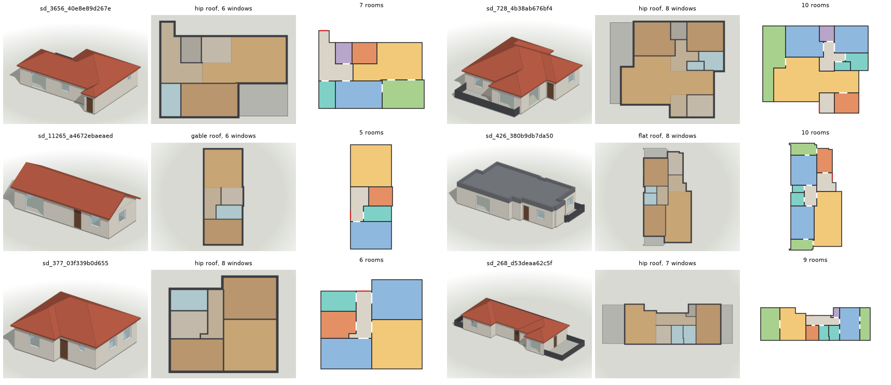
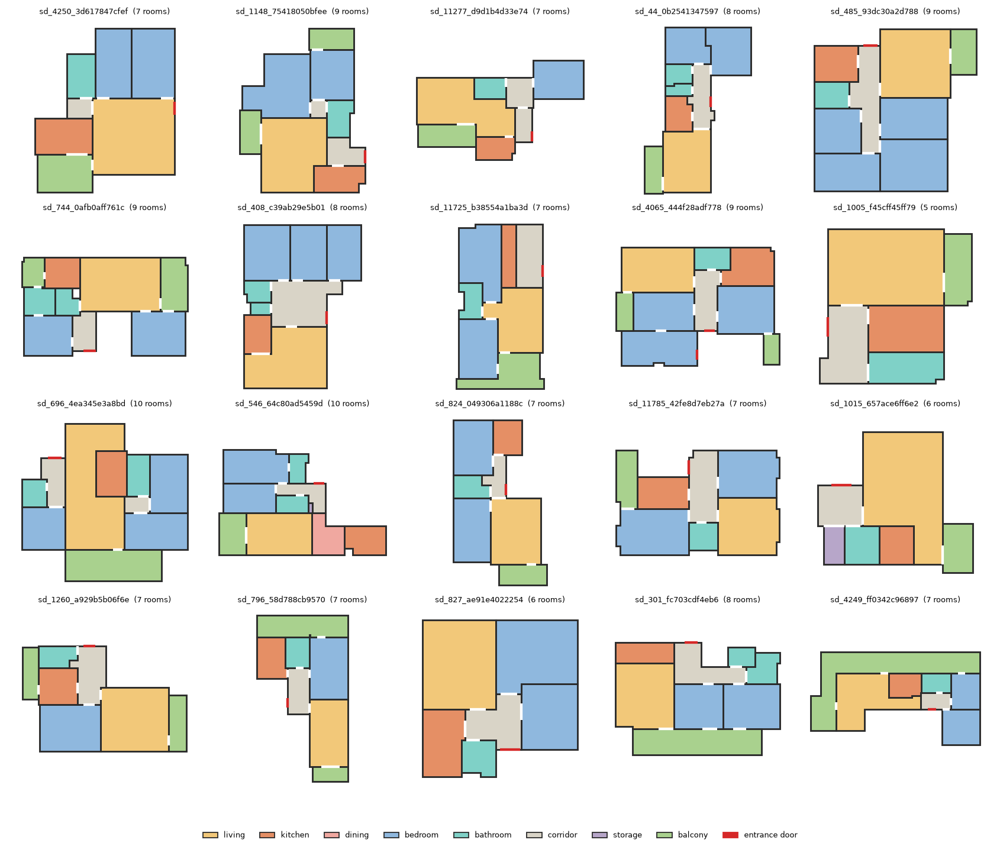
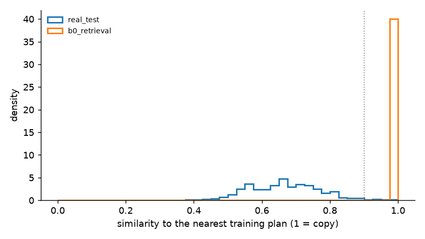
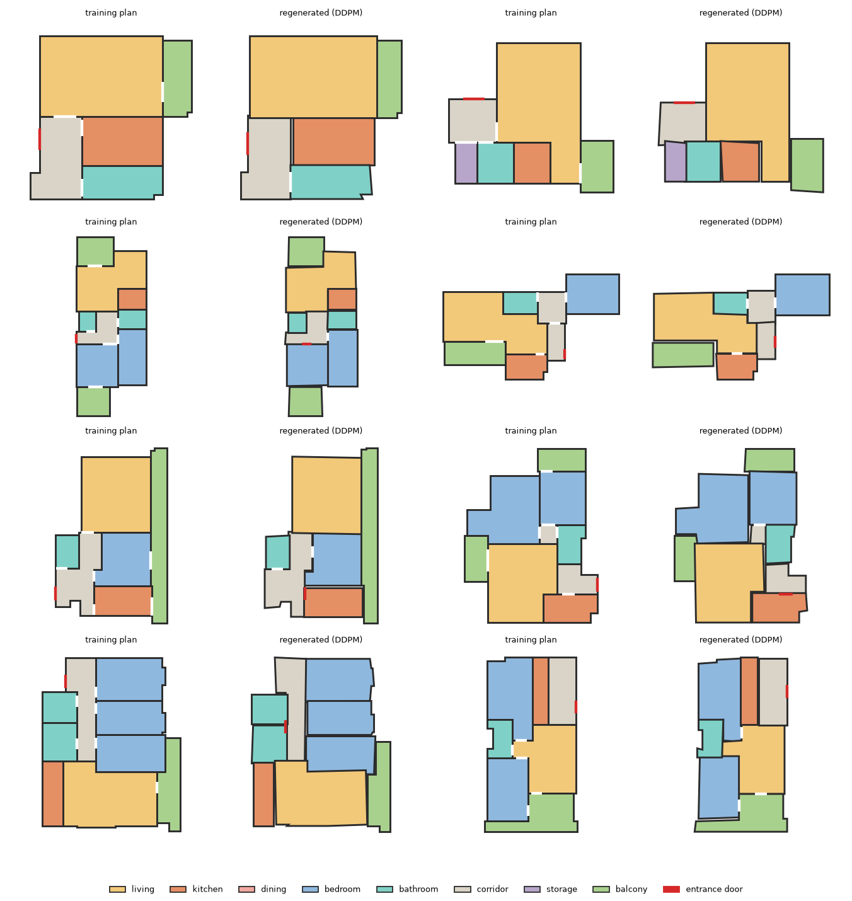

# genHouse3D

*[English version](README.md)*

Générer des maisons 3D nouvelles à partir de graphes de pièces : un modèle de diffusion de
plans d'étage, suivi d'une extrusion 3D procédurale.

> **État : en cours de développement.** Les jalons 1 (données), 2 (pipeline 3D sur de vrais
> plans), 3 (évaluation et baseline de récupération) et 4 (modèle de diffusion, mis au point)
> sur 8 sont terminés. Le modèle n'a pas encore été entraîné sur l'ensemble du jeu de
> données : chaque maison ci-dessous est extrudée à partir d'un plan **réel** du jeu de
> données, et non d'un plan généré.



## Pipeline (cible)

graphe de pièces → modèle de diffusion → plan 2D → nettoyage géométrique → maison 3D (GLB)

## Données

Les plans proviennent de [Swiss Dwellings v3.0.0](https://doi.org/10.5281/zenodo.7788422) :
un plan par appartement de plain-pied, tourné pour s'aligner sur les axes, avec des pièces
qui partagent leurs arêtes sur une grille de 10 cm, un graphe des portes et un découpage
entraînement / validation / test figé, par site. Les effectifs, les motifs de rejet et les
distributions sont dans le [rapport sur les données](reports/data_report.md), généré
automatiquement.



## Pipeline 3D

`housegen.geometry3d` transforme un plan en maison et l'exporte au format GLB, en 50 ms
environ :

- **Murs** : murs extérieurs de 20 cm construits vers l'extérieur de l'emprise, cloisons de
  10 cm centrées sur les arêtes partagées par deux pièces, aucune entre des pièces ouvertes
  l'une sur l'autre.
- **Ouvertures** : les portes du plan ; des fenêtres sur les murs extérieurs selon le type de
  pièce (baies pour le séjour, petite fenêtre haute pour la salle de bains, aucune pour le
  cellier), placées avec une graine.
- **Toits** : toit à quatre pans obtenu par le squelette droit de l'emprise, toit à deux pans
  quand l'emprise est à peu près rectangulaire, toit plat avec acrotère en secours.
- **Vue en coupe** : `roof="none"` exporte la maison sans son toit.

Le squelette droit est implémenté dans le dépôt pour les emprises rectilignes (voir
[docs/decisions.md](docs/decisions.md)) et vérifié par rapport à une formule exacte de la
hauteur du toit. Les taux mesurés sur le jeu de test sont dans
[reports/results/roof_stats_real.csv](reports/results/roof_stats_real.csv) ; la galerie
complète de 20 plans de test tirés au hasard est [ici](reports/figures/3d/gallery_real.png).

## Évaluation

`make evaluate` évalue chaque méthode sur les 1 309 graphes de test, avec cinq plans par
graphe, et écrit les tableaux dans [reports/results/](reports/results/). Aucun modèle n'est
encore entraîné ; les deux lignes ci-dessous sont les références auxquelles il sera comparé.

| Méthode | FID ↓ | Distance d'édition au graphe ↓ | Graphe entièrement respecté ↑ | Valides ↑ | Diversité ↑ | Similarité au plan d'entraînement le plus proche | Copies (≥ 0,9) | Écart de surfaces (m²) ↓ |
|---|---|---|---|---|---|---|---|---|
| Plans réels du test (référence) | 0,0 | 0,0 | 100 % | 99,2 % | n/a | 0,667 | 2,0 % | 0,0 |
| B0 : récupération du graphe d'entraînement le plus proche | 5,96 | 1,086 | 51,2 % | 99,1 % | 0,689 | 1,0 | 100 % | 0,627 |

- **Les plans réels du test** sont évalués après qu'on a retiré leurs portes et qu'on les a
  reposées à partir de la seule géométrie : les 1 309 retrouvent exactement leur graphe, ce
  qui valide la métrique de compatibilité. Leur similarité au plan d'entraînement le plus
  proche (0,667 en moyenne) montre à quoi ressemble un plan « nouveau » sur ce jeu de données.
- **B0** renvoie de vrais plans d'entraînement : réalistes et valides, mais tous sont des
  copies, et seule la moitié respecte le graphe demandé. Un générateur doit le battre sur la
  compatibilité tout en restant très en dessous de lui sur le taux de copie.



Les définitions des métriques sont dans [docs/decisions.md](docs/decisions.md) et dans
`housegen/metrics.py`.

## Modèle

Un modèle de diffusion sur les **coins des pièces**, inspiré de HouseDiffusion (Shabani et
al., CVPR 2023) et écrit à partir de l'article :

- un jeton par coin, conditionné par le type de sa pièce, l'indice du coin, le nombre de
  coins de sa pièce, une identité de pièce et un indicateur d'entrée ;
- dans chaque couche, trois attentions masquées sont additionnées : à l'intérieur de la
  pièce, sur tous les coins, et entre les pièces reliées dans le graphe demandé
  ([masques](src/housegen/model/masks.py)) ;
- prédiction du bruit sur des coordonnées dans [-1, 1], planning cosinus, 1 000 pas ;
  échantillonnage DDPM pour l'évaluation, DDIM pour la démo ; les coins sont arrondis à la
  grille de 10 cm à la fin ;
- 10,6 M de paramètres (6 couches, largeur 256), pas de temps injecté par adaLN-Zero, poids
  EMA.

**Tests de bon fonctionnement avant tout entraînement long**
([overfit.csv](reports/results/overfit.csv), [resume_check.csv](reports/results/resume_check.csv)) :

- *Surapprentissage de 32 plans* (sans augmentation, 6 000 pas, 4,7 min sur une RTX 2070) :
  la perte descend de 0,99 à 0,0024. Régénérés à partir de leurs graphes, les 32 plans
  ressemblent aux originaux avec une similarité de 0,945 en moyenne (0,875 au pire) ; les
  coins tombent en moyenne à 10 cm de leur cible (36 cm au pire). Ces coins bruts ne sont pas
  encore nettoyés : les murs de pièces voisines coïncident donc rarement exactement et aucune
  porte ne peut être posée (0 % des graphes retrouvés) ; avec une tolérance de 20 cm sur les
  murs partagés, 88 % (DDPM) et 91 % (DDIM) sont retrouvés exactement. Le nettoyage
  géométrique est le jalon suivant.
- *Tué puis relancé* : un entraînement tué brutalement au pas 700 (dernier point de reprise
  au pas 500) reprend au pas 500 avec la même commande et se termine avec des poids EMA
  **identiques au bit près** à ceux d'un entraînement sans interruption, sur GPU. La même
  propriété est testée unitairement sur processeur.
- *Précision mixte* : le fp16 avec mise à l'échelle des gradients entraîne 1,6 fois plus vite
  sur la RTX 2070 (33 contre 21 pas/s), avec la même perte et aucun pas sauté.



## Reproduire

Nécessite [uv](https://docs.astral.sh/uv/) et Python 3.12.

```bash
uv sync --extra cu126   # PyTorch avec CUDA 12.6 ; --extra cpu sur une machine sans GPU
```

Téléchargez `swiss-dwellings-v3.0.0.zip` (932 Mo) depuis la fiche Zenodo et extrayez
`geometries.csv` dans `data/raw/swiss_dwellings/swiss-dwellings-v3.0.0/`, puis :

```bash
make data      # jeu brut -> plans au format interne, filtres, découpage
make viz       # rapport sur les données
make build3d   # 20 plans réels -> GLB dans outputs/, validation, statistiques des toits
make render    # figures de la galerie
make evaluate  # métriques de la référence et des baselines (télécharge une fois les poids de la FID)
make overfit   # test de bon fonctionnement : mémoriser 32 plans et les régénérer
make train     # entraîner ou reprendre le modèle de diffusion (AMP=--amp pour le fp16)
make test
```

Chaque cible correspond à une commande `uv run --extra cu126 python -m ...` (voir le
[Makefile](Makefile)), qu'on peut lancer directement là où `make` n'est pas installé.

Les choix de conception sont consignés dans [docs/decisions.md](docs/decisions.md) (en
anglais).

## Crédits et licences

- **Données** : Standfest et al., *Swiss Dwellings: a large dataset of apartment models*
  (v3.0.0), Archilyse AG, [doi:10.5281/zenodo.7788422](https://doi.org/10.5281/zenodo.7788422),
  sous licence [CC BY 4.0](https://creativecommons.org/licenses/by/4.0/deed.fr). Tout ce qui
  en dérive dans ce dépôt (les plans dessinés dans les figures, les fixtures de test, les
  fichiers de découpage, `app/graphs_test.json`, les tableaux de résultats) est partagé sous la
  même licence. Modifications : les appartements ont été tournés, redressés, alignés sur une
  grille et convertis au format du projet.
- **Inspiration du modèle** : Shabani, Hosseini et Furukawa, *HouseDiffusion: Vector Floorplan
  Generation via a Diffusion Model with Discrete and Continuous Denoising*, CVPR 2023. Le code
  du modèle est écrit à partir de l'article, et non repris de l'implémentation officielle,
  dont la licence en limite l'usage au non commercial.
- **Bibliothèques** : shapely, trimesh, numpy, networkx, matplotlib, PyTorch, pytorch-fid.
- **Code** : [MIT](LICENSE).
