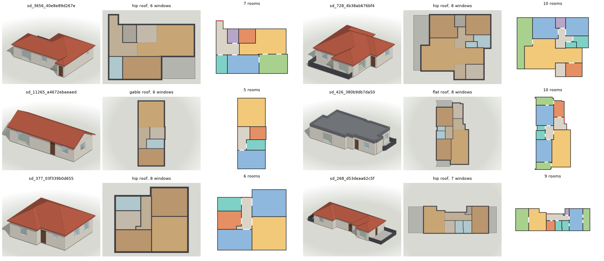
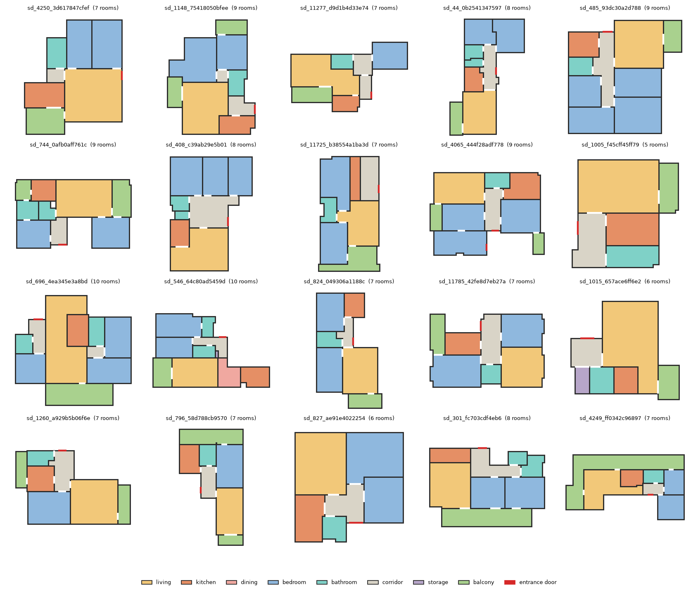
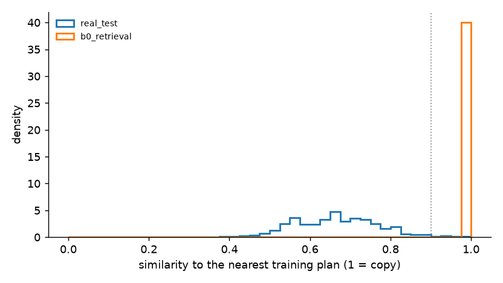
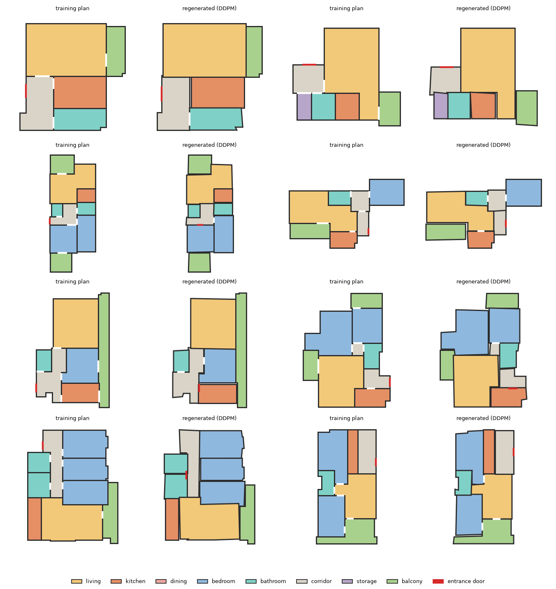

# genHouse3D

*[Version française](README.fr.md)*

Generating novel 3D houses from room graphs: a floorplan diffusion model followed by procedural
3D extrusion.

> **Status: work in progress.** Milestones 1 (data), 2 (3D pipeline on real plans),
> 3 (evaluation and retrieval baseline) and 4 (diffusion model, debugged) of 8 are done. The
> model has not been trained on the full dataset yet: every house below is extruded from a
> **real** plan of the dataset, not from a generated one.



## Pipeline (target)

room graph → diffusion model → 2D floorplan → geometric clean-up → 3D house (GLB)

## Data

Plans come from [Swiss Dwellings v3.0.0](https://doi.org/10.5281/zenodo.7788422): one plan per
single-storey apartment, rotated onto the axes, with rooms sharing edges on a 10 cm grid, a
door graph and a frozen train / val / test split by site. Counts, rejection reasons and
distributions are in the generated [data report](reports/data_report.md).



## 3D pipeline

`housegen.geometry3d` turns a plan into a house and exports it as GLB, in about 50 ms:

- **Walls**: 20 cm outer walls built outwards from the footprint, 10 cm partitions centred
  on shared room edges, none between rooms that are open onto each other.
- **Openings**: doors from the plan; windows on outer walls by room type (bays for the
  living room, a small high window for the bathroom, none for storage), seeded.
- **Roofs**: hip roof from the straight skeleton of the footprint, gable roof when the
  footprint is roughly rectangular, flat roof with parapet as fallback.
- **Cutaway**: `roof="none"` exports the house without its roof.

The straight skeleton is implemented in the repository for rectilinear footprints (see
[docs/decisions.md](docs/decisions.md)) and checked against a closed-form roof height.
Measured rates over the test split are in
[reports/results/roof_stats_real.csv](reports/results/roof_stats_real.csv); the full gallery
of 20 random test plans is [here](reports/figures/3d/gallery_real.png).

## Evaluation

`make evaluate` scores every method on the 1,309 test graphs, five plans per graph, and
writes the tables in [reports/results/](reports/results/). No model is trained yet; the two
rows below are the references it will be compared with.

| Method | FID ↓ | Graph edit distance ↓ | Fully compatible ↑ | Valid ↑ | Diversity ↑ | Similarity to nearest training plan | Copies (≥ 0.9) | Area distance (m²) ↓ |
|---|---|---|---|---|---|---|---|---|
| Real test plans (reference) | 0.0 | 0.0 | 100 % | 99.2 % | n/a | 0.667 | 2.0 % | 0.0 |
| B0: retrieval of the closest training graph | 5.96 | 1.086 | 51.2 % | 99.1 % | 0.689 | 1.0 | 100 % | 0.627 |

- **Real test plans** have their doors stripped and re-derived from the geometry before
  scoring: all 1,309 recover their graph exactly, which checks the compatibility metric.
  Their similarity to the nearest training plan (0.667 on average) is what "new" looks like
  on this dataset.
- **B0** returns real training plans: realistic, valid, but every one is a copy, and only
  half match the requested graph. A generator has to beat it on compatibility while
  staying far below it on the copy rate.



Metric definitions are in [docs/decisions.md](docs/decisions.md) and `housegen/metrics.py`.

## Model

A diffusion model over the **corners of the rooms**, after HouseDiffusion (Shabani et al.,
CVPR 2023), written from the paper:

- one token per corner, conditioned on its room type, corner index, the corner count of its
  room, a room identity and an entrance flag;
- in every layer three masked attentions are summed: within the room, across all corners,
  and between rooms connected in the requested graph
  ([masks](src/housegen/model/masks.py));
- noise prediction on coordinates in [-1, 1], cosine schedule, 1,000 steps; DDPM sampling
  for evaluation, DDIM for the demo; corners are rounded to the 10 cm grid at the end;
- 10.6 M parameters (6 layers, width 256), timestep through adaLN-Zero, EMA weights.

**Sanity checks before any long training** ([overfit.csv](reports/results/overfit.csv),
[resume_check.csv](reports/results/resume_check.csv)):

- *Overfitting 32 plans* (no augmentation, 6,000 steps, 4.7 min on an RTX 2070): the loss
  falls from 0.99 to 0.0024. Regenerated from their graphs, the 32 plans match the originals
  with a layout similarity of 0.945 on average (0.875 at worst); corners land 10 cm from
  their target on average (36 cm at worst). These raw corners are not yet cleaned up, so
  walls of neighbouring rooms rarely coincide exactly and no door can be placed (0 % of the
  graphs recovered); with a 20 cm tolerance on shared walls, 88 % (DDPM) and 91 % (DDIM)
  are recovered exactly. Geometric clean-up is the next milestone.
- *Killed and relaunched*: a run hard-killed at step 700 (last checkpoint at step 500)
  resumes from step 500 with the same command and ends with EMA weights **identical bit for
  bit** to an uninterrupted run, on the GPU. The same property is unit-tested on CPU.
- *Mixed precision*: fp16 with a gradient scaler trains 1.6 times faster on the RTX 2070
  (33 vs 21 steps/s) with the same loss and no skipped step.



## Reproduce

Requires [uv](https://docs.astral.sh/uv/) and Python 3.12.

```bash
uv sync --extra cu126   # PyTorch with CUDA 12.6; use --extra cpu on a machine without GPU
```

Download `swiss-dwellings-v3.0.0.zip` (932 MB) from the Zenodo record and extract
`geometries.csv` to `data/raw/swiss_dwellings/swiss-dwellings-v3.0.0/`, then:

```bash
make data      # raw dataset -> unified plans, filters, split
make viz       # data report
make build3d   # 20 real plans -> GLB in outputs/, validation, roof statistics
make render    # gallery figures
make evaluate  # metrics of the reference and the baselines (downloads the FID weights once)
make overfit   # sanity check: memorise 32 plans and regenerate them
make train     # train or resume the diffusion model (AMP=--amp for fp16)
make test
```

Each target wraps one `uv run --extra cu126 python -m ...` command (see the [Makefile](Makefile)), which
can be run directly where `make` is not installed.

Design choices are logged in [docs/decisions.md](docs/decisions.md).

## Credits and licences

- **Data**: Standfest et al., *Swiss Dwellings: a large dataset of apartment models* (v3.0.0),
  Archilyse AG, [doi:10.5281/zenodo.7788422](https://doi.org/10.5281/zenodo.7788422),
  licensed under [CC BY 4.0](https://creativecommons.org/licenses/by/4.0/). Everything derived
  from it in this repository (the plans drawn in the figures, the test fixtures, the split
  files, `app/graphs_test.json`, the result tables) is shared under the same licence. Changes:
  apartments were rotated, rectified, snapped to a grid and converted to the project format.
- **Model inspiration**: Shabani, Hosseini and Furukawa, *HouseDiffusion: Vector Floorplan
  Generation via a Diffusion Model with Discrete and Continuous Denoising*, CVPR 2023. The
  model code is written from the paper, not taken from the official implementation, whose
  licence restricts it to non-commercial use.
- **Libraries**: shapely, trimesh, numpy, networkx, matplotlib, PyTorch, pytorch-fid.
- **Code**: [MIT](LICENSE).
