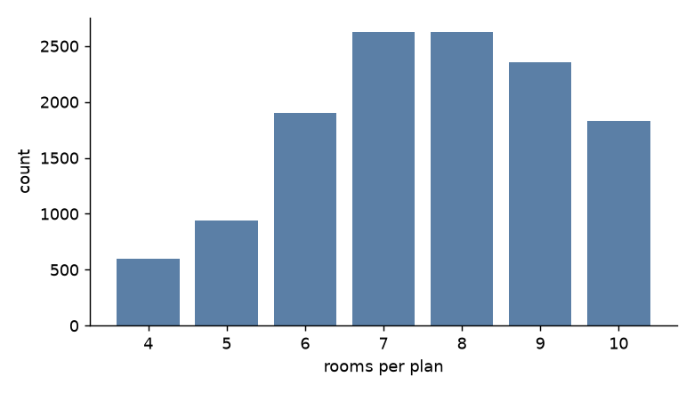
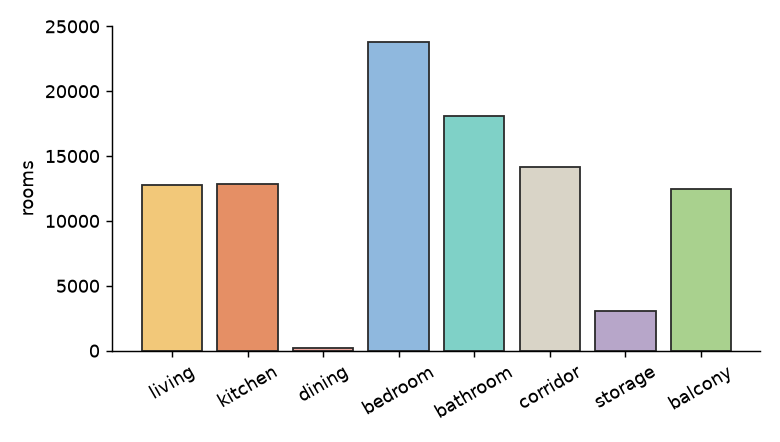
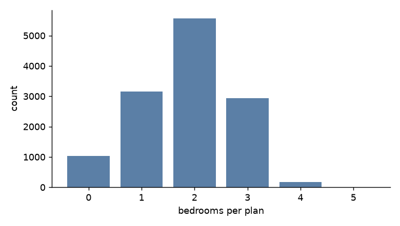
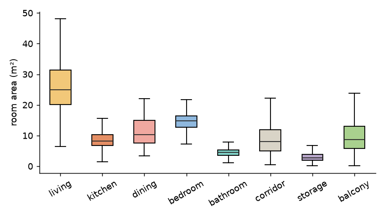
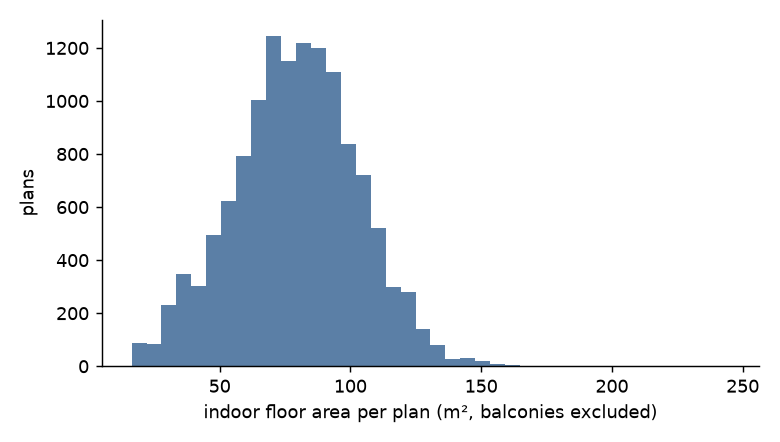
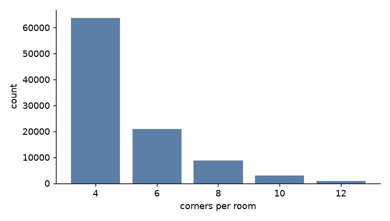
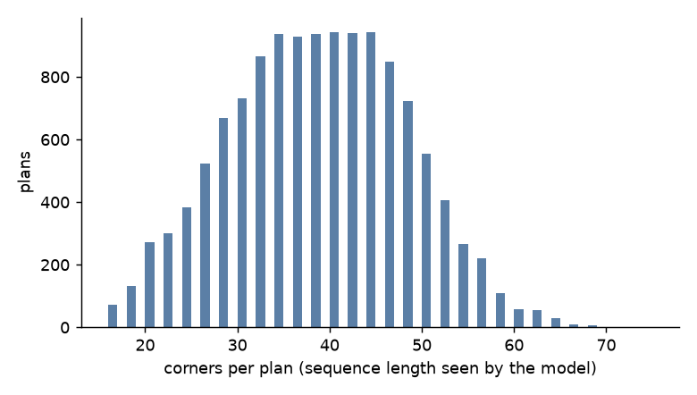
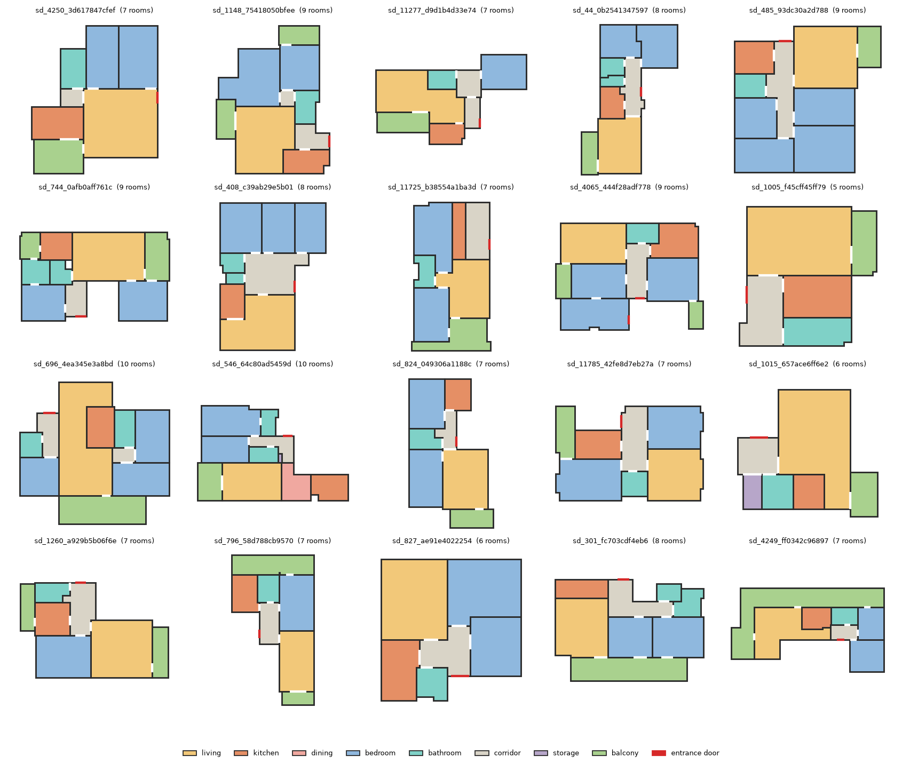

# Data report: swiss_dwellings

Generated by `make viz` (`python -m housegen.data.report`). Do not edit by hand.

Source: [10.5281/zenodo.7788422](https://zenodo.org/records/7788422), licence CC BY 4.0. One plan is one single-storey apartment, rotated onto the axes and snapped to a 10 cm grid (256 x 256 units, 25.6 m). Rooms share edges: walls have no thickness in this format.

## From raw dwellings to plans

| Step | Dwellings |
|---|---|
| Residential apartments in the raw file | 44957 |
| Converted to the unified format | 32552 |
| Passing the filters | 26263 |
| Duplicates removed (same layout up to rotation / mirroring) | 13394 |
| **Kept** | **12869** |

Rejections, most frequent first:

| Reason | Dwellings | Meaning |
|---|---|---|
| `non_rectilinear` | 9738 | a room has a slanted or curved wall (the format is rectilinear) |
| `too_many_rooms` | 3566 | more rooms than `filters.max_rooms` |
| `multi_floor` | 1629 | apartment spread over several floors (duplex) |
| `too_few_rooms` | 1030 | fewer rooms than `filters.min_rooms` |
| `too_many_corners` | 966 | a room has more corners than `filters.max_corners_per_room` |
| `disconnected_graph` | 683 | a room cannot be reached through doors or openings |
| `unsupported_room_type` | 581 | contains an area outside the type table (staircase, office...) |
| `overlapping_rooms` | 184 | rooms overlap after wall closing |
| `degenerate_room` | 166 | a room collapses when snapped to the grid |
| `door_without_shared_wall` | 71 | a door links two rooms that share no wall after wall closing |
| `no_entrance` | 44 | no entrance door could be placed on an outer wall |
| `too_large` | 36 | does not fit in the 25.6 m canvas |

## Split

Plans are split by site (a site groups the buildings of one development, which often share layouts), so near-identical plans never sit on both sides. Ids are frozen in `configs/splits/`.

| Split | Plans | Share | Sites |
|---|---|---|---|
| train | 10271 | 79.8 % | 893 |
| val | 1289 | 10.0 % | 113 |
| test | 1309 | 10.2 % | 127 |

## Rooms

| Type | Rooms | Plans with at least one | Median area (m²) |
|---|---|---|---|
| living | 12741 | 98.9 % | 25.0 |
| kitchen | 12829 | 99.6 % | 8.2 |
| dining | 219 | 1.7 % | 10.3 |
| bedroom | 23818 | 92.0 % | 14.8 |
| bathroom | 18061 | 100.0 % | 4.4 |
| corridor | 14150 | 95.8 % | 8.1 |
| storage | 3068 | 22.3 % | 2.7 |
| balcony | 12463 | 85.2 % | 8.7 |

The dataset labels many rooms with a generic `ROOM` type. In 2965 plans (23.0 %) no living room is annotated and the largest generic room was relabelled `living`; the other generic rooms count as `bedroom`.

## Areas

| Quantity | 5 % | 25 % | median | 75 % | 95 % |
|---|---|---|---|---|---|
| Indoor floor area per plan (m²) | 36.9 | 63.8 | 79.6 | 94.7 | 118.1 |
| Largest side of the bounding box (m) | 8.1 | 10.8 | 12.6 | 14.4 | 17.3 |

## Corners

Corners per plan: median 38, 95th percentile 54, maximum 74.

## Room graph

| Connection | Count | Per plan |
|---|---|---|
| door | 77179 | 6.00 |
| open | 13615 | 1.06 |

`door`: a door on the shared wall. `open`: the two rooms touch without a wall (open kitchen, corridor opening onto the living room).

## 20 random training plans

